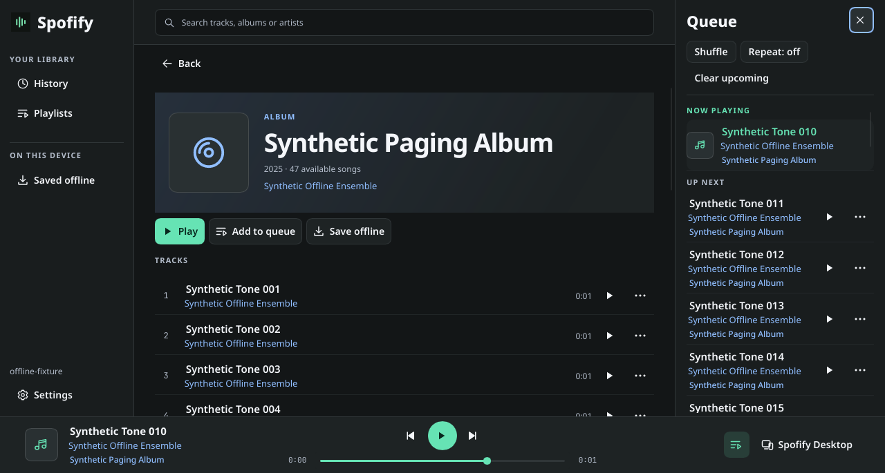

# Spofify Desktop

A native Linux music player for your [Spofify server](../spofify-go). Rust owns the session, music library and playback; Slint renders the desktop window and Rodio sends audio to the default output. The server and its music library run separately.



[Compact Now Playing screenshot](docs/images/native-player-compact.png)

## Run

Install stable Rust (at least the `rust-version` in `Cargo.toml`), a C/C++ toolchain, `pkg-config`, and development headers for fontconfig and ALSA. On Debian/Ubuntu the native packages include `build-essential pkg-config libfontconfig1-dev libasound2-dev`. For playback you need a working audio output and a Wayland or X11 desktop session.

```sh
cargo run --release --locked
```

Use the root URL of a Spofify server that supports the account WebSocket with v3 playback JSON and no WebSocket subprotocol, such as `https://music.example.com`, and sign in with an existing listener or admin account. The desktop client is for listening; server administration stays in the Go dashboard. Both `http://` and `https://` addresses work directly, including hostnames with a port. Use HTTPS on untrusted networks; HTTP sends credentials unencrypted. Do not enter a path, credentials, query, or fragment in the server field.

After a successful sign-in the app remembers the server and username. Select **Keep me signed in** to reopen the app without typing your password. This uses an unlocked Linux desktop keyring that provides the Secret Service interface and a server session, not a saved password. Sign out to stop automatic sign-in on this computer.

## Listening

- Start in **History**, or open your **Playlists** from the library navigation. Search the catalog with `Ctrl+F`. Results come from the server’s unified search index, in ranked order; the desktop doesn’t download a catalog to search it. Select an artist or album to open its page, then use Back to return to your results.
- Play a whole collection or start from a particular occurrence. Use a track’s `…` menu to queue it, save it offline, or add it to a playlist. Use a manual or rule playlist’s **Save offline** action to download it in the background. **Saved offline** shows progress and resumes pending downloads when you’re back online with the same account. Use **Work offline** to play a download queue in its saved order. When this desktop owns playback in a connected account queue, it uses a verified download before requesting the audio from the server.
- Use **Edit order** on the queue or an editable manual playlist. In the queue, press and drag a song in Up Next to its new position, then release to place it. In a playlist, hold the row briefly before dragging. With the keyboard, use ↑/↓ to select a row, Space or Enter to lift it, ↑/↓ or Home/End to choose its destination, and Space or Enter to place it. Escape cancels a lift. GNOME and KDE animation preferences are read at launch; `SPOFIFY_REDUCED_MOTION=1` also disables reorder animations.
- Select the current track’s artwork or title to open **Now playing**. Queue and output controls stay at the right of the mini-player. The selected output is shared with other connected listeners on your account. The desktop can control another output or play through its own default audio device. Linux desktop environments can use MPRIS media keys for play/pause, next and previous.
- **Work offline** switches the same browsing, Search, and playback controls to music available on this device. Known playlists open normally and keep their downloaded tracks in order, including repeats. Offline actions are not replayed as online commands or counted as online history. An unowned room can adopt a nonempty local queue when you reconnect; a live owner keeps its shared queue. Saved music survives restarting the application. A remembered account can open locally with your unlocked keyring. **Go online** validates the same account before connecting; saved files alone cannot unlock an account.
- Enable **Crossfade** in Settings to blend up to five seconds at natural track endings on this desktop. It is off by default and stored in `playback.json` alongside `appearance.json`. It does not affect another selected output or change the shared queue. If the next track cannot be prepared in time or either track is too short, playback advances normally.
- **Settings → Music storage** shows the current account’s downloaded audio on this device. Desktop has no persistent automatic music cache. **Settings → Density** applies to this computer only. The local density file is `$XDG_CONFIG_HOME/spofify-desktop/appearance.json` (default `~/.config`). Private saved audio lives under `$XDG_DATA_HOME/spofify-downloads-v1` (default `~/.local/share`). Downloads use available disk space without a per-track size limit. Online playback uses temporary private disk space; it does not add tracks to Saved.

See [shared state](docs/shared-state.md) for the desktop/server transport and ownership rules.

## Install in the desktop menu

```sh
make build
make install PREFIX="$HOME/.local"
```

Ensure `$HOME/.local/bin` is on the desktop session's `PATH`. To remove the binary and launcher, use `make uninstall PREFIX="$HOME/.local"`. This does not delete personal data. Distributors can stage the same files with `DESTDIR`; `BINARY` can point to an already-built executable. No root access or user service is required for a per-user install.

## Install a GitHub release

On Linux x86-64 (Ubuntu 24.04 or newer, or an equivalent desktop with glibc 2.39+, ALSA and fontconfig), download the installer archive from [official GitHub Releases](https://github.com/Baizey/spofify-desktop/releases), extract it, and run `bash install.sh`. Then open **Spofify** from the app menu. No Rust installation is needed. If you used `make install` before, use the app menu rather than an older `spofify-desktop` on your shell `PATH`.

Spofify checks for and installs verified updates in the background when it starts, even before sign-in. It does not check in **Work offline**. When the top notice says an update is ready, quit and reopen Spofify to use it. To update manually, close Spofify and rerun `install.sh` from the latest official release. Either way, your settings, sign-in, and saved music stay in place.

See [desktop releases](docs/desktop-release.md) for how updates are verified or how to publish a package.

## Development

```sh
cargo fmt --all -- --check
cargo test --locked
cargo build --locked
```

With a provisioned Cargo cache you can add `--offline` to the build/test commands. If native libraries were installed with Linuxbrew rather than the system package manager, expose them to the build with `export PKG_CONFIG_PATH="$(brew --prefix)/lib/pkgconfig${PKG_CONFIG_PATH:+:$PKG_CONFIG_PATH}"`.

The default build does not enable Slint's inspection server. For development with **disposable accounts only**, build with `SLINT_EMIT_DEBUG_INFO=1 cargo build --locked --features slint/mcp`, then launch that **debug binary** with `SLINT_MCP_PORT` on an unused unprivileged loopback port. Never expose an inspection session containing real credentials. `scripts/inspect-native.py` captures only the opt-in Slint app window and accessibility tree.

For v3 playback interoperability, use the [Rust cross-native tests](docs/native-listener.md) with the disposable Go fixture. The older [Python v1 wire scenarios](scripts/acceptance/README.md) do not work against the v3 socket.

`python3 scripts/acceptance/run.py --help` lists the disposable Go HTTP checks, window-only sign-in screen check, and real-Go playlist save/unpin check. For either window check, point `--desktop` at the MCP-enabled debug binary. On a mediated Linux worker, use `--scratch-dir /dev/shm` for disposable fixture state.

For offline relaunch without a playback socket peer, use `python3 -B scripts/acceptance/offline_session_relaunch.py --seeded-offline --desktop /path/to/mcp-enabled/spofify-desktop --scratch-dir /dev/shm`.

To capture native reorder motion without a playback socket peer, build `cargo build --locked --example reorder_preview` and run `target/debug/examples/reorder_preview scripts/acceptance/reorder-motion.events <new-frame-directory> soft` in a private Cage session on a 1280×720 output. Use `line` to compare the alternative cue or `reorder-edges.events` to exercise the long list and keyboard.

## Credits

The waveform icon follows the Spofify mobile mark. [JetBrains Mono 2.304](https://github.com/JetBrains/JetBrainsMono/releases/tag/v2.304) is bundled unmodified under the [SIL Open Font License](assets/JetBrainsMono-OFL.txt).
